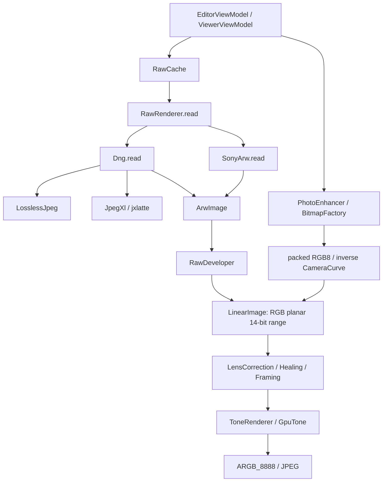
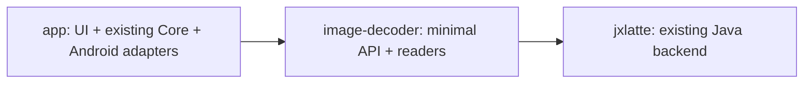

# Latent 아키텍처 평가 및 Image Decoder 계획

작성: Codex · 2026-10-21 (Asia/Seoul)

분석 기준: 로컬 `main`, `553e176f8c1b58046fe35311d8bfe75391e322d3`

상태: **독립 평가 초안, 유지보수자 승인 전. 구현을 시작하지 않는다.**

이 문서는 사용자가 제시한 *Latent — Architecture Assessment & Image Decoder Planning*에 대한 평가다. 사전에 존재하는 `codex-assessment.md`는 없었다. 소스·설정·테스트를 읽었고, 이번 평가에서는 의존성 설치, 빌드, 테스트 실행, 실사진 디코딩, 원격 CI 조회를 하지 않았다. 이전 세션의 테스트 결과를 이번 평가의 실행 증거로 사용하지 않는다. Antigravity 평가를 읽거나 가정하지 않았다.

표시 규칙:

- **Verified**: 현재 저장소의 코드·설정·테스트 정의에서 직접 확인했다. 실행 성공이나 모든 기기 지원을 뜻하지 않는다.
- **Inferred**: 확인한 코드에서 도출한 영향·위험이다. 측정이나 재현이 추가로 필요하다.
- **Proposed**: 승인 후 적용할 권고다. 아래 새 타입·파일·모듈·테스트 이름은 모두 제안이다.
- **Unverified**: 실제 샘플, 장치, 벤치마크 또는 외부 검토가 필요하다.

소스 참조 `[E01]` 등의 실제 경로와 심볼은 §12에 모았다. 외부 후보 라이브러리는 §7의 공식 문서를 2026-10-21에 확인했으며, 특정 버전 채택을 승인한 것은 아니다.

## 1. Executive summary

1. **Verified — 디코더를 처음부터 만들 상황이 아니다.** `SonyArw`는 자체 Kotlin ARW 2.3 리더다. `Dng`는 mosaic/linear DNG, 무압축·lossless JPEG·JPEG XL을 이미 처리한다. JPEG XL은 순수 Java `:jxlatte`를 사용한다. “Expert RAW/JPEG XL은 계획만 있다”는 입력 배경은 현재 코드와 다르다. 다만 모든 Samsung 모드·기기를 지원한다는 증거는 없다. [E02–E06]
2. **Proposed — 우선 `app + image-decoder + jxlatte`를 목표로 한다.** 기존 Core와 Android 통합은 `app`에 남긴다. 승인된 최소 계약을 `image-decoder`의 API에 함께 두고, 별도 `image-contract`와 `image-core`는 실제 독립 소비자가 생길 때 다시 판단한다. 모듈 수와 에이전트 수를 맞출 필요는 없다.
3. **Verified / Inferred — 정밀도와 색 의미가 가장 큰 계약 문제다.** `LinearImage`는 RGB planar `ShortArray`, 0…16383이다. RAW 색 변환은 이 범위로 clipping하며, JPEG/HEIF 입력은 packed 8-bit 채널을 거쳐 카메라 룩의 역곡선으로 들어온다. 현재 동작을 곧바로 범용 scene-linear/HDR 파이프라인이라고 부를 수 없다. [E07–E10]
4. **Verified / Inferred — 안정성은 추출보다 먼저 기준을 세워야 한다.** 전체 파일 입력, 대형 배열, 공유 가변 버퍼, 동기식 캐시 잠금, 협력적 취소의 부재가 연결된다. jxlatte의 잘린 입력 대기 문제는 `cf6a263`에서 수정됐지만 DNG wrapper와 이후 요청 회복까지 검사해야 한다. [E03–E07, E11–E13]
5. **Proposed — 계약 변경에 한정한 교차 검토가 적절하다.** Codex/Claude Code는 포맷 리더와 Core를 각각 맡되, 공유 계약은 공동 책임이다. Argon/Opus는 독립적인 근거 검토에 사용하고, 의견 충돌과 통합은 사람이 결정한다. 모델 이름만으로 정확성이나 승인 권한을 부여하지 않는다.

## 2. Verified current architecture

### 2.1 Gradle 및 패키지

| 구분 | Verified 내용 | 근거 |
|---|---|---|
| 프로젝트 | 루트 이름 `Latent`; `:app`, `:jxlatte`만 include | E01 |
| `:app` | Android application, Compose, KSP/Room schema export. compile/target SDK 37, min SDK 35; Java source/target 17 | E01 |
| `:jxlatte` | `third_party/jxlatte`, Java library, Java 17; 디코더 자체 JNI 없음 | E01, E06 |
| 도구 | AGP 9.4.1, Kotlin 2.4.21, KSP 2.3.12을 version catalog에서 지정. AGP built-in Kotlin 사용. wrapper Gradle 9.8.1; CI JDK 21 | E01, E17 |
| 앱 구성 | `camera/` MTP import; `data/` 파일·Room·캐시; `location/` EXIF/위치; `backup/`; `ui/` Compose/ViewModel; `raw/` 리더와 현상·Android 어댑터가 함께 있음; `enhance/` 편집·CPU/GPU 처리 | E02, E07–E16 |
| Android 의존성 | Bitmap/EXIF, EGL/GLES31, Context, MediaStore 계열, Room, Coil, Media3, LiteRT/GPU, lifecycle/coroutines | E01, E10, E14–E16 |

현재 Gradle 방향은 `:app → :jxlatte`다. 아래는 **패키지 호출 흐름**이며 별도 모듈 관계를 뜻하지 않는다.

`Thumbnails`는 MPF 내 JPEG preview 또는 `BitmapFactory`의 축소 디코딩을 사용하고 `ThumbnailFetcher`가 Coil로 전달한다. 전체 RAW 현상과 구분되는 표시 경로다. `MpfPreview`는 HDR gain map을 preview와 구분하는 MPF 타입 검사를 한다. [E14]

### 2.2 테스트와 CI

**Verified:** `app/src/test`는 JUnit 4, Robolectric, Compose UI test를 사용한다. `SonyArwTest`, `DngTest`, `LosslessJpegTest`, `JpegXlTest`, `RawDeveloperTest`, `LensCorrectionTest`, `RawRendererTest` 및 synthetic fixture가 있다. JVM 테스트 heap은 2 GiB로 설정되어 있어 폰의 메모리 보장을 대신하지 않는다. [E01, E18–E21]

`RawSampleTest`는 `ARW_SAMPLE_DIR`/`DNG_SAMPLE_DIR`이 없으면 skip한다. ARW는 대응 JPEG와 위치 오차를 비교하지만 DNG 경로는 현상 결과 저장 중심이며 색 정확도 golden 판정이 아니다. `RawOnDeviceTest`는 `arwSample` 인자를 받고 6000×4000, `ZV-E10`을 기대하므로 범용 DNG 장치 검증으로 간주하면 안 된다. [E20]

`build.yml`은 PR에서 JVM test, debug/release lint, instrumentation APK **컴파일**, shader의 `glslangValidator` 검사, Room schema diff, privacy 검사, arm64 release APK를 수행하도록 정의되어 있다. instrumentation **실행**이나 이번 HEAD의 CI 성공을 확인한 것은 아니다. nightly/release도 test·lint·release build가 있지만 모든 workflow의 검사 구성이 동일하지는 않다. [E17]

## 3. Existing dependencies and image processing flow

### 3.1 리더와 현상의 책임

| 단계 | Verified 구현 | 의미 |
|---|---|---|
| 선택 | `RawRenderer.read(File)`가 `readBytes()` 후 `Dng.isDng`, 아니면 `SonyArw.read` | MIME/capability registry가 없는 두 리더 분기. `MediaKind.fromFileName`의 RAW 확장자는 ARW/DNG뿐이며 `.jxl` 파일은 목록에 포함되지 않음 |
| Sony ARW | TIFF/SubIFD, Sony private directory unscramble, 32767 압축, RGGB, tone curve, WB/matrix/lens profile 추출 | libraw나 Android RAW 디코더 호출이 아닌 기존 자체 Kotlin 구현; 모든 Sony RAW 변형 지원은 아님 |
| DNG 컨테이너 | `PhotometricInterpretation` 32803/34892, 8…16-bit, mosaic 1채널 또는 interleaved 3채널, strips/tiles | lossless JPEG 7, JPEG XL 52546, 무압축 1을 분기 |
| DNG 전처리 | `Levels.apply → brighten → GainMap.apply` 후 `ArwImage` | black/white·linearization·양의 `BaselineExposure`·gain map이 이미 반영됨. 미가공 sensor sample과 다름 |
| JPEG XL tile | `JXLDecoder.decode`, `getBuffer(false)`의 int/float planes를 `ShortArray`에 interleave | codec plane은 참조로 받고 최종 DNG sensor로는 복사. float 분기는 0…1 가정 후 정수 양자화 |
| 현상 | `RawDeveloper.develop`: mosaic는 PPG demosaic; 3채널은 demosaic 없이 color stage. `developPreview`는 블록 평균 | preview는 축소 출력이지만 RAW entropy decode 자체는 전체 수행 |
| 색 단계 | black/WB, highlight clamp, 정규화 matrix와 saturation, 0…16383 RGB로 변환 | 색 해석·룩이 리더/현상에 분산 |
| 출력 | lens/geometry/healing → tone/local/color/LUT → detail → JPEG | `RawRenderer.export`, `PhotoEnhancer`가 Android Bitmap으로 인코딩 |

근거: [E02–E10, E15].

### 3.2 색, 전송함수, ICC

**Verified:** `ArwImage.colorMatrix` 주석은 white-balanced sensor→linear sRGB 3×3이다. DNG의 `Colors`는 `ColorMatrix1/2` 중 daylight 순위로 하나만 선택하고 calibration·analog balance·`AsShotNeutral`을 사용한다. 두 광원 보간, `AsShotWhiteXY`, OpcodeList3 처리는 확인한 `Dng.kt`에 없다. Sony는 fallback matrix와 saturation 1.45, DNG는 saturation 1을 쓴다. [E02, E03]

`RawDeveloper.ColorStage`는 matrix 행 합을 1로 맞추고 saturation을 합성한 뒤 범위를 자른다. **Inferred:** 고정밀 colorimetric 변환과 카메라 JPEG 룩 일치를 별도 목표로 분리해야 한다. 이 normalization과 실제 조명에서의 정확성은 샘플 없이 판정할 수 없다. [E07]

`LinearImage.fromArgb`는 표준 sRGB inverse EOTF만 적용하지 않고 `CameraCurve.levelOfDisplay`를 사용한다. `CameraCurve`는 ZV-E10 측정 기반 밝기 lift/roll-off와 sRGB 전달을 합친 룩이다. **Inferred:** rendered JPEG에서 복원한 값은 편집용 pseudo-scene 값이며 원래 장면 radiance를 되찾은 것이 아니다. RAW와 JPEG가 같은 숫자 범위를 쓴다는 이유만으로 같은 물리 의미라고 간주하면 안 된다. [E08, E09]

**Verified:** 앱 경로에 ICC를 명시적으로 받아 변환하는 계약이나 `inPreferredColorSpace` 지정은 발견하지 못했다. `JXLImage`에는 primaries, transfer, ICC, premultiplied alpha 정보가 있지만 Latent의 `JpegXl` 어댑터는 이를 노출하지 않는다. **Unverified:** 플랫폼 Bitmap 디코더가 개별 ICC/HDR 입력을 어떻게 처리한 뒤 현재 `getPixels(IntArray)` 경로로 전달하는지는 장치·파일 검증이 필요하다. float sample이라는 사실만으로 linear RGB라고 판정하지 않는다. [E05, E06, E10]

### 3.3 메타데이터·방향·출력

`ArwImage`는 crop, orientation, WB/matrix/lens를 갖지만 촬영 시각·노출·원본 ICC 전체를 담는 metadata envelope는 아니다. `MediaMetadataReader`와 `ExifIndex` 등 앱 계층이 별도로 EXIF를 읽는다. `ArwImage.sensor`는 저장 방향이고 preview는 회전한다. 기본 RAW export는 저장 방향+EXIF orientation을 유지하고, reframe/local mask가 있으면 방향을 픽셀에 반영한다. [E02, E11, E16]

`RawRenderer.quarterTurnsOf`, `PhotoEnhancer.uprightTurnsOf`는 1/3/6/8의 회전만 처리한다. `Thumbnails.upright`는 flip도 처리한다. **Inferred:** 미러 orientation 2/4/5/7에서 thumbnail과 editor/export의 좌표가 불일치할 수 있다. 회귀 테스트가 필요하다. [E10, E11, E14]

JPEG 편집의 `JpegMetadata.withExifOf`는 원본 APP1 EXIF를 옮겨 MakerNote를 보존하려 한다. RAW/HEIF→JPEG의 `copyExif`는 선택한 tag만 복사한다. 원본 ICC APP2/XMP 전체 보존과 같지 않다. `JpegMetadataTest.keepsOtherApplicationDataOfTheImage`는 **인코딩 결과 쪽** APP2 보존을 확인하며, 원본 ICC의 왕복 보존을 보장하지 않는다. 원본 프로파일은 보관하되 다른 색 공간으로 변환한 출력에 그대로 붙이지 않아야 한다. [E10, E19]

### 3.4 Native 및 외부 라이브러리

**Verified:** 소유한 RAW 경로에 `external fun`, `System.loadLibrary`, CMake/JNI build 설정은 없고 jxlatte는 Java다. Core는 EGL/GLES31을 호출하며 LiteRT/GPU 의존성이 있다. **Unverified:** 이번 평가에서 APK를 만들거나 `.so`/전이 의존성을 조사하지 않았으므로 “앱 전체에 native 코드가 없다”고 결론내리지 않는다. vendored jxlatte는 MIT, 앱은 Apache-2.0이고 라이선스 공지가 assets에 있다. [E01, E06, E23]

## 4. Architectural issues and risks

| ID / 우선도 | 상태·근거 | 영향과 권고 |
|---|---|---|
| R1 / P0 | **Verified:** `raw` 안의 `RawRenderer`가 Bitmap/PhotoEdit/Healing/Framing을 참조. `Dng`도 `enhance.forRowBands`를 import [E03, E11] | **Inferred:** `raw/` 전체를 JVM 모듈로 이동하면 역의존/순환을 만듦. 리더와 frame carrier만 추출하고 helper는 decoder 소유로 옮기거나 순차 루프로 대체; Core 전체 유틸 모듈은 불필요 |
| R2 / P0 | **Verified:** 14-bit `LinearImage`, WB/matrix 후 clamp, DNG `Levels`에서 정수 재양자화 [E03, E07–E09] | **Inferred:** negative/out-of-gamut, highlight headroom, 16-bit 원본 단계가 소실될 수 있음. 모듈 추출과 정밀도 재설계를 한 변경으로 묶지 말 것 |
| R3 / P0 | **Verified:** ICC/encoding envelope 없음, inverse CameraCurve와 fixed sRGB 가정 [E08–E10] | **Inferred:** wide-gamut/HDR/렌더된 JXL을 DNG sensor tile처럼 취급하면 잘못된 색/톤. source encoding·실제 pixel encoding·적용된 보정을 분리 |
| R4 / P0 | **Verified:** `ArwImage.part`는 sensor/matrix 배열 공유; cache가 같은 객체 반환; editor region lambda가 raw를 캡처 [E02, E12, E13] | **Inferred:** `clear()`는 다른 참조를 해제하지 못하며 `val`은 배열 불변성을 보장하지 않음. read-only lease 규칙과 Core 작업 버퍼의 단독 소유를 명시 |
| R5 / P0 | **Verified:** 파일 전체 `readBytes`, full sensor, codec plane, RGB planes, IntArray와 Bitmap 단계 [E05, E07, E10–E12] | **Inferred:** 12 MP RGB short만 72 MB(약 68.7 MiB), 24 MP RGB F32만 288 MB(약 274.7 MiB). 동시 cache/export/old Source가 peak를 높임. 단계별 live set을 측정하고 예산 승인 후 변경 |
| R6 / P0 | **Verified:** `RawCache.read`의 `@Synchronized`가 decode 전체를 포함; decode loops/codec API에 cancellation token 없음; jxlatte background future 경로 [E06, E12, E13] | **Inferred:** UI coroutine 취소가 CPU 작업 종료나 lock 해제를 즉시 보장하지 않음. malformed DNG 후 다음 요청 회복, 취소·부분 결과 폐기·worker 종료 검증 필요 |
| R7 / P0 | **Verified:** DNG는 210M photosite cap이나 channel/temporary byte 예산 아님. Sony의 `ShortArray(width * height)`는 동일한 dimension cap 없음; TIFF offset 파싱은 부분적으로 예외 변환에 의존 [E02–E04] | **Inferred:** 공개 입력에서 작은 파일도 큰 allocation을 유도할 수 있음. `Long` 산술·offset/count/size 검증·codec dimension 확인을 할당 전에 적용. 재현 전 보안 취약점 확정 표현은 하지 않음 |
| R8 / P1 | **Verified:** 방향 처리 차이, EXIF 선택 복사 [E10, E11, E14, E19] | **Inferred:** 미러 방향·마스크 좌표·원본 ICC/XMP 보존이 모호. EXIF 1…8, crop·region·export를 계약 테스트로 묶음 |
| R9 / P1 | **Verified:** `Dng.Colors` daylight 하나 선택, gain map 이외 opcodes 생략, `lens=null` [E03] | **Inferred:** 지원 파일도 조명/렌즈에 따라 정확성이 제한됨. 두 광원/warp를 별도 feature로 검토하고 지원하지 않는 필수 보정은 조용히 완료했다고 표현하지 않음 |
| R10 / P1 | **Verified:** `LinearImage.downscaled`와 `.turned`, `LensCorrection` plane copy, GPU upload/readback [E08, E15] | **Inferred:** 일부 복사는 필수 resampling·alias 방지이며 모두 중복은 아님. zero-turn alias와 copy API 차이를 문서화하고 측정 없이 zero-copy로 변경하지 않음 |
| R11 / P1 | **Verified:** 실사진 테스트는 선택적이고 CI는 장치 테스트를 컴파일만 함 [E17–E21] | **Inferred:** CI green은 색·폰 메모리·GPU 동일성의 충분조건이 아님. 별도 장치 release gate 필요 |

jxlatte README의 “4000×3000을 384 MB heap에서 디코딩”은 **저장소에 기록된 과거 측정**이다. 이번 재측정이나 모든 파일의 상한이 아니다. `android:largeHeap=true`도 메모리 안전성 계약을 대신하지 않는다. [E06, E23]

## 5. Recommended module structure

### 5.1 후보 네 모듈 평가

| 후보 | 판단 (Proposed) | 구체적 이유·추출 조건 |
|---|---|---|
| `app` | 유지 | UI/lifecycle/storage/EXIF/export, Android bitmap adapter와 기존 Core의 통합 지점 |
| `image-decoder` | 최소 계약 승인 후 JVM library로 추출할 근거 있음 | TIFF/ARW/DNG/LosslessJpeg/JpegXl은 대부분 JVM 코드. 독립적인 손상 입력·sample 테스트와 소유권 격리에 이점. `forRowBands` 역의존 제거가 선행 |
| `image-contract` | 처음에는 별도 Gradle 모듈을 만들지 않음 | Core가 app 안에 있으면 소비자는 app/decoder 관계 하나. contract를 decoder의 API package에 두어도 한 방향. 독립 `image-core`·추가 소비자·외부 배포가 실제 생기면 분리 |
| `image-core` | 보류 | `enhance`는 Android GPU/Bitmap, 앱 저장소/룩까지 연결. 코드 이동 비용에 비해 현재 독립 실행 소비자가 없음. Core package ownership과 교차 review로 당장 협업 가능 |

**가장 작은 대안:** 승인된 계약·테스트를 `app` 안의 package 경계로 먼저 도입한다. 추출 PR의 빌드 시간/변경 빈도 이점이 없으면 현행 두 Gradle 모듈을 그대로 유지해도 된다. 모듈 추출은 목표 자체가 아니라 검증·독립성이 실제 개선되는 경우의 수단이다.

목표 추출 후 의존성 (**Proposed**, 화살표는 compile 의존성):

추후 독립 Core가 정당화될 때만 `app → image-core/image-decoder`, 양쪽 `→ image-contract`로 바꾼다. contract는 app/Core/decoder 어느 구현도 참조하지 않는다. `image-decoder → app` 또는 `image-decoder ↔ image-core`를 허용하지 않는다.

### 5.2 이동 범위와 점진 이행

1. **Proposed:** API/semantics 테스트를 현행 `app`에서 먼저 고정한다. 이름 변경·precision 변경 없이 legacy adapter를 둔다.
2. `Tiff`, `SonyArw`, `Dng`, `LosslessJpeg`, `JpegXl`와 frame/lens carrier를 추출한다. 초기에는 기존 package와 `ArwImage` 이름을 유지해 diff를 줄일 수 있다. 범용 명칭 변경은 별도 API 승인 대상이다.
3. `RawDeveloper`, `LensCorrection`, `RawRenderer`, `RawCache`, `LinearImage`는 app에 남긴다. `ArwImage`는 app 타입에 의존하지 않는다. Sony lens 데이터와 DNG warp를 같은 Sony 전용 배열에 억지로 넣지 않는다.
4. `MpfPreview`는 decoder 소유지만 RAW 추출의 필수 구성은 아니다. app 내 `internal` 소비자/테스트를 유지하고 별도 후속 작업에서 필요한 최소 API만 이동한다.
5. 리더의 pure tests와 fixture는 decoder로, Android `RawRendererTest`/기기 테스트는 app에 남긴다. `internal` 접근과 `SyntheticArw`/`SyntheticDng`의 양쪽 사용을 먼저 확인하고, 공유가 필요하면 테스트 전용 fixture만 제공한다. production API를 테스트 때문에 public으로 넓히지 않는다.
6. Kotlin/JVM plugin, Java 17 bytecode, Android consumer 호환성을 검증한다. 현행 AGP built-in Kotlin과 별개로 JVM module의 plugin 적용은 추출 PR에서 명시한다. 별도 라이브러리 module에 `Bitmap`, Room, Compose, Context를 유입시키지 않는다.

## 6. Core–Decoder shared contract requirements

**Proposed:** 아래는 요구사항이며 승인된 인터페이스 선언이 아니다. `SensorMosaic`, `CameraLinearRgb`, `RenderedRgb`는 의미를 설명하는 가칭이다. 하나의 envelope가 필요하더라도 세 payload를 구분해야 한다. mosaic를 RGB로 간주하거나, demosaic된 camera RGB를 sRGB로 표시하지 않는다.

### 6.1 RAW 의미와 변환 책임

| 의미 | 최소 정보 | Decoder / Core 책임 |
|---|---|---|
| Sensor mosaic | CFA pattern·원점, stored/active/crop 크기, bit depth·black/white, WB·camera calibration, 적용된 보정 | Decoder는 구조/압축 해제와 명시한 정규화까지만; demosaic·작업 색 변환·룩은 Core |
| Camera-linear RGB | camera-space RGB임을 명시, channel layout, calibration·WB·applied processing | demosaic하지 않음. Core가 calibration·WB를 중복 적용하지 않도록 처리 이력 필요 |
| Rendered RGB | 실제 pixel primaries/white/transfer/ICC, display/scene 의미와 alpha | 렌더된 tone curve를 RAW sensor 처리로 재적용하지 않음. 초기에 Android 경로는 app에 유지 |

**v0 호환 원칙:** 현재 DNG 리더는 이미 levels·baseline·gain map을 반영한다. 추출 첫 단계에서 이를 옮겨 색 결과를 바꾸지 않는다. 대신 원본 bit depth와 출력 범위, applied stages를 구분하고 “원본 sample 보존”이라고 주장하지 않는다. raw normalization을 Core로 옮기는 v1은 정밀도 연구와 golden 검증 후 독립 승인한다.

### 6.2 Pixel representation

| 항목 | 초기 계약에 필수 | 보류 가능한 구현 |
|---|---|---|
| U16 | 16-bit storage와 유효 bits/range를 분리. JVM `Short`를 원본 U16로 읽을 때 unsigned 의미를 명시; legacy 정규화 값은 0…32767 제한. 32768/65535 bit-pattern 테스트 | 모든 Core 연산을 U16 full range로 바꾸는 일 |
| U8 | 지원 여부를 명시; 기존 Android rendered RGB8 변환점을 기록 | Android JPEG/HEIF를 새 decoder API로 통합 |
| F16/F32 | 둘 다 storage일 뿐 transfer/scene 의미를 결정하지 않는다는 규칙 | F16 구현, 범용 float buffer hierarchy. F32는 정밀도 prototype에서 먼저 비교하고 HDR 승인 전 채택 여부 결정 |
| RGB/RGBA | 실제 채널 순서와 수. mosaic는 1채널; 현행 linear DNG는 RGB interleaved, Core는 planar RGB | alpha 지원·다중 extra channel. v0는 opaque만 수용하고 비지원 alpha를 묵살하지 않음 |
| layout | plane 수, packed/interleaved 여부, offset·row stride의 단위, valid dimensions; heap 배열은 row padding 없음 | 임의 stride/하드웨어 alignment 구현. native 추가 때 byte stride와 native byte order 검증 |
| alpha | 없음/straight/premultiplied를 서로 다른 의미로 취급 | alpha drop·합성 정책은 별도 승인; 기존 `ToneRenderer`는 opaque 출력 |
| domain | normalized range·clipping·색 encoding·적용된 보정을 명시 | negative/over-1 보존은 F32 Core 도입 gate; 현재 경로가 지원한다고 표기하지 않음 |

`ArwImage.sensor`의 unsigned 입력과 정규화 후 signed-positive buffer, `LinearImage` 14-bit buffer를 같은 “U16 image”로 포장해서는 안 된다. 전달 범위 검증을 한 번 정한 경계에서 수행하고, 내부 픽셀 루프마다 방어 복사를 추가하지 않는다.

### 6.3 Color management와 metadata

**초기 필수 (Proposed):**

- source encoding과 반환된 pixels의 encoding을 별도로 보유한다. primaries/white point/transfer를 알고 있는지, ICC가 있는지, camera-native인지 표시한다. 모르는 색을 자동 sRGB로 확정하지 않는다.
- 원본 ICC bytes의 보존과 실제 CMS 변환을 구분한다. ICC 보존만으로 색 관리 완료라 하지 않는다. Decoder는 profile/calibration을 보고하고 Core의 단일 변환 경계가 작업 공간으로 변환한다. backend가 이미 변환했다면 실제 output profile을 함께 반환한다.
- scene/display-referred 구분, exposure scale, normalization·WB·gain map 적용 여부를 기록한다. PQ/HLG/HDR의 luminance 기준이 없으면 HDR 지원으로 선언하지 않는다.
- orientation 1…8, stored dimensions, active area, default crop, 원본 및 현재 좌표계를 보존한다. orientation은 한 번만 적용하며 적용 후 metadata도 갱신한다. standalone JXL codestream 방향과 DNG 내부 tile 방향은 같은 정책으로 단순 합성하지 않는다.
- camera make/model/lens, exposure/ISO/focal length, capture time/offset 등 필요한 tag와 원본 파일 참조를 분리한다. 전체 파일을 중복 보관하는 metadata 객체를 만들지 않는다. 원본의 opaque EXIF/XMP/ICC는 크기 제한을 두고 보존 전략을 정한다.
- export 담당 Core/app은 수정한 dimensions·orientation·출력 profile·위치 제거 정책에 맞춰 metadata를 재작성한다. 원본 MakerNote/ICC를 무조건 결과에 복사하지 않는다. 원본 파일 복원은 기존 보존 경로를 유지한다.

**후속:** 임의 ICC CMS의 선택, 광색역 작업 공간, chromatic adaptation의 기준, HDR/float export. 이들은 승인·검증된 고정밀 편집을 주장하기 전 필수지만 모듈 이동의 선행 조건은 아니다. native F32 출력 하나만 추가해 해결됐다고 간주하지 않는다.

### 6.4 Memory, lifecycle, cancellation

- **초기 필수:** decoder가 완성한 heap sample은 소비자에게 read-only로 제공한다. Core는 별도 작업 배열을 소유한다. `part` 같은 view는 parent 수명을 연장하며, cache eviction과 객체 해제를 구분한다. 문서상 불변과 실제 `ShortArray` 가변성의 제약을 adapter에서 통제한다.
- 입력 차용 기간은 decode 호출 동안, 성공 결과는 독립된 수명을 갖도록 한다. 실패·취소 때 미완성 결과는 publish하지 않는다. heap-only v0에 형식적인 `close()`/reference-counting framework는 추가하지 않는다.
- metadata 검사 후 예상 output·scratch·입력 bytes를 `Long`으로 합산하여 승인된 요청 예산을 확인한다. JVM heap·native heap·GPU texture/direct buffer를 별도 계측한다. thread 수와 동시 full decode 수에 상한을 둔다.
- app은 off-main scheduling과 cache를 담당한다. decoder는 요청별 상태를 분리하고 공유 mutable singleton 작업 버퍼를 만들지 않는다. 캐시가 공유하는 frame을 CPU/GPU가 동시에 수정하지 않는다.
- 취소는 **계약상 필수**다. reader의 tile/row 경계와 codec의 실행 중단 가능 지점을 구분한다. `withTimeout`이나 `Job.cancel()`만으로 jxlatte worker가 끝난다고 약속하지 않는다. 중단 불가능한 backend는 그 제한을 capability로 보고하고 bounded worker/queue 정책을 승인받아야 한다.
- **Native를 도입할 때 필수:** 단일 소유 handle, 명시적 release, use-after-close 금지, 예외·취소 시 runner/decoder/입출력 buffer 정리, callback lifetime, JNI global ref 제거. direct buffer를 사용해도 codec 내부 복사나 GPU upload가 없어지는 것은 아니다.

### 6.5 Decoder behavior

| 초기에 필수 | 후속으로 보류 |
|---|---|
| 짧은 header probe와 포맷 판별; DNG tag·Sony make/압축 지원 확인; extension은 힌트 | ServiceLoader/동적 plugin registry |
| 고정 순서의 소수 decoder 목록; `unsupported format/variant`, `corrupt`, `resource limit`, `I/O`, `cancelled` 구분 및 원인 보존 | 풍부한 telemetry나 에러 계층 framework |
| 지원 format/variant/precision, full decode와 preview/downsample의 실제 가능 여부를 명시 | 모든 포맷의 native scaled decode/ROI |
| 요청 크기 제한, 원본 픽셀과 preview 픽셀의 크기·crop·좌표 연결 | 스트리밍/부분 decode가 이득이라는 측정 전 구현 |
| unsupported alpha/HDR/float/필수 보정을 조용히 성공시키지 않는 정책 | standalone `.jxl`·animation·depth/추가 채널 |

초기 API는 한 repository 내부 API이며 외부 SDK ABI를 약속하지 않는다. capability가 `preview`라고 해도 “full decode 후 resize”인지 codec-level 축소인지 구분한다. unsupported DNG가 ARW 파서로 흘러 잘못된 형식 오류가 되는 현 분기도 진단 보완 대상이다.

## 7. Image Decoder roadmap와 backend 비교

### 7.1 기존 지원을 보존할 이유

**Proposed:** Sony reader·PPG·렌즈 보정을 유지한다. 광범위 RAW 라이브러리 교체는 지원 카메라 확대, 명확한 오류 수정, 메모리/정확도 개선의 측정이 있을 때 검토한다. 현행 saturation과 CameraCurve는 calibrated look이라는 별도 값이므로 decoder 계약 정리와 함께 몰래 변경하지 않는다.

Expert RAW의 우선 과제는 새 JXL 지원이 아니라 **현행 경로의 검증과 제한 명시**다. synthetic fixture는 DNG 안의 compression 52546과 3-channel linear RAW 경로를 입증한다. `DEVICE_CHECKS.md`는 Galaxy S26 Pro lossless JPEG / Expert RAW JPEG XL의 과거 샘플 결과를 기록하지만, 이번 세션에서 그 원본을 직접 검사하지 않았다. 모든 Samsung Expert RAW가 같은 구조라는 주장은 **Unverified**다. [E03, E18, E22]

### 7.2 JPEG XL 후보

| 후보 | 확인한 사실 | 기술적 평가 (Inferred / Proposed) |
|---|---|---|
| 기존 jxlatte | Java, MIT, upstream pin·`latent.patch`, 현재 DNG adapter와 회귀 테스트 존재 [E06, E18] | 초기 기본 backend 유지. Android ABI/JNI 신규 비용이 없으나 heap·전체 decode·취소·색 metadata adapter 제한은 측정 필요 |
| libjxl | 공식 C decoder API에 output buffer/callback, profile, orientation·alpha 설정이 있음. `JxlPixelFormat`은 interleaved 출력 형식, allocator API 존재 | NDK/CMake·JNI·각 ABI·native heap·오류 경계를 추가해야 함. callback으로 최종 목적지에 쓰는 방안은 있지만 zero-copy나 작은 전체 working set은 실측 전 미확정 |
| Rust `jxl-oxide` | Rust decoder. `rayon` 기본 병렬화; ICC용 `moxcms`는 Rust, `lcms2`는 C 의존성 추가. MIT/Apache-2.0 선택 라이선스 | Android용 Rust target/linker, JNI/FFI wrapper, panic/취소·thread 제한·ABI 검증 필요. pure Rust가 Kotlin이나 Android native build 불필요를 뜻하지 않음 |

libjxl API와 pixel/allocator 사실은 [공식 Decoder API](https://libjxl.github.io/libjxl/api_decoder.html), [Common API](https://libjxl.github.io/libjxl/api_common.html)에서 확인했다. native build는 [공식 BUILDING.md](https://github.com/libjxl/libjxl/blob/main/BUILDING.md)의 CMake/의존성 구조를 확인했다. 라이선스 표기는 [공식 README](https://github.com/libjxl/libjxl/blob/main/README.md)를 따른다. Rust 후보의 기능과 라이선스는 [jxl-oxide README](https://github.com/tirr-c/jxl-oxide/blob/main/README.md), feature 구성은 [Cargo.toml](https://github.com/tirr-c/jxl-oxide/blob/main/crates/jxl-oxide/Cargo.toml)을 따른다. 성능 우열·Android 완성도는 이번 조사로 검증하지 않았다.

**Proposed 선택 gate:** 동일한 권리 확보 fixture, 같은 output sample/색 변환 정책, 같은 thread 수에서 jxlatte와 후보를 비교한다. cold/warm latency, peak managed/native/RSS, APK/ABI 크기, 정확도, malformed/cancel 후 잔여 worker를 보고한다. DNG tile에는 임의의 CMS·tone map을 적용하지 않도록 codec sample과 container calibration의 관계부터 확인한다. standalone rendered JXL과 별도 adapter로 취급한다.

Native 선택 시 초기 실기기 `arm64-v8a`, emulator `x86_64`를 검증하고, 다른 ABI를 유지할지 사람이 결정한다. 현재 앱이 다른 ABI를 패키징할 수 있으므로 조용히 줄이지 않는다. 새 `.so`는 16 KB ELF 및 APK alignment와 실제 load를 검사한다. Android의 직접/전이 native 의존성과 16 KB 검증 요구는 [공식 page-size 안내](https://developer.android.com/guide/practices/page-sizes)를 참조한다. Rust 의존성을 포함해 pin·license notice·보안 advisory 확인을 비교 gate에 넣는다. 이번에는 어떤 backend도 설치/컴파일하지 않았다.

### 7.3 테스트 기준

**Proposed:** golden fixture에는 생성법·권리·checksum·format tags·참조 decoder/version·expected pixels/encoding을 함께 기록한다. 사적인 카메라 사진을 무단으로 공개 저장소에 넣지 않는다. 작은 synthetic fixture를 mandatory CI에 두고 공개 허락된 실사진은 별도 opt-in corpus로 관리한다.

| 검사 | 합격 기준 | 필수 시점 |
|---|---|---|
| 손상/자원 | truncated DNG의 tile byte count, 잘못된 TIFF offset/dimensions, 압축 데이터 과대 크기: 제한된 시간 안에 실패하고 다음 정상 decode 성공 | 기존 안정성 보완, M1 전 |
| numerical | lossless samples는 bit-exact; 0/32767/32768/65535, crop 경계·odd width·RGB 순서. float 도입 시 finite·negative·over-1·변환 오차를 별도 승인 | M1/M2, float은 해당 milestone |
| color/ICC | profile bytes/hash 보존, source/output encoding 불일치 거부, gray·primaries·WB 기준값. 변환 경로는 독립 reference와 승인 tolerance | M1 envelope, CMS·색 변경 merge 전 |
| orientation | 1…8의 회전/미러를 비대칭 grid로 확인; crop/region/mask/export 왕복에서 한 번만 적용 | M3 |
| golden | 기계적 이동은 기존 U16/14-bit 픽셀 bit-exact; 의도적 색 변경은 별도 golden과 승인한 수치 tolerance. JPEG byte 동일성으로 색 정확도를 판정하지 않음 | M3, M4 |
| lifetime/취소 | parent view 유지, cache clear 후 기존 reader 유효, read-only buffer 오염 없음; 실패/취소 후 반쪽 결과 없음·정상 재요청 회복. native이면 close/error 경로 leak 검사 | M1/M2; native M4 |
| 메모리/통합 | 12/24 MP 및 승인된 최대 크기에서 decode→preview→edit→export와 연속 열기. peak/잔여 메모리와 latency를 기준 revision에 비교 | M4 backend 결정, M5 release gate |
| 장치 | 실제 CPU/GPU 결과 비교, R8 release load, native ABI/16 KB 실행; 테스트 누락은 skip가 아니라 release 보류 근거 | 관련 native/정밀도 변경 출하 전 |

수치 허용오차·최대 메모리/latency는 임의로 “안전”하다고 정하지 않는다. M0에서 대상 장치·reference를 정하고 M4/M5에서 기준선을 측정해 상한을 승인받는다. 테스트 threshold를 통과시키기 위해 느슨하게 바꾸지 않는다.

## 8. Cross-agent collaboration workflow

### 8.1 역할과 계약 소유

| 참여자 | 권고 책임 (Proposed) | 한계 |
|---|---|---|
| Codex | 리더/codec adapter·해당 fixture·성능/손상 검증. critical Core 변경 검토 | 색/메모리 계약을 단독 변경하지 않음 |
| Claude Code | Core·Android adapters·앱 통합. critical decoder 변경 검토 | 디코더 내부 정확성을 모델 이름이나 CI만으로 승인하지 않음 |
| Argon / Antigravity | 같은 revision의 독립 repo 분석·분해·대안 제시 | 새 소스 사실은 근거 확인 후 채택; 구현 파일 선점 권한을 자동 부여하지 않음 |
| Opus / Antigravity | Argon의 주장·대안에 독립 반박 검토 | Argon과 의견이 같다는 이유만으로 결정 확정하지 않음 |
| Human maintainer | 요구 품질·범위·자원 예산·계약·통합 승인 | 최종 결정권 유지 |

현재 HANDOFF의 소유 범위는 유지한다. `RawDeveloper`, `LensCorrection`, `RawRenderer`, `RawCache`, `ArwImage`/`LensProfile` 및 `LinearImage`의 의미 변경은 공동 검토 대상으로 한다. 독립 contract 모듈 유무와 상관없이 API의 책임자는 Core/Decoder 양측이며 최종 승인자는 사람이다.

### 8.2 GitHub 절차

1. 구현마다 `codex/<topic>` 또는 Claude의 독립 branch/worktree를 사용한다. 한 branch의 두 에이전트 동시 checkout·동일 작업 트리 수정을 피한다. 이 문서 작업에서는 새 worktree/branch를 만들거나 merge하지 않았다.
2. `HANDOFF.md`의 유효한 선점 규칙을 따른다. 파일·심볼·기간·branch/PR를 명시하고, 같은 shared 파일은 순서대로 작업한다. `settings.gradle.kts`, version catalog, CI, fixture 생성기는 공동 파일이다. CODEOWNERS 설정은 후속 제안이며 현재 존재한다고 가정하지 않는다.
3. significant interface change는 **제안 → 독립 검토 → 반대 근거 해결 → 사람의 계약 승인 → 구현 → 자동 검증**으로 진행한다. `image-contract.md`/`architecture-decisions.md`는 승인 단계에서 작성하고 이번에는 만들지 않는다.
4. major semantics(좌표계·색 공간·buffer 소유·range·오류 의미)를 바꾸면 변경 목록·이전 소비자·호환 adapter·전환 순서를 PR에 붙인다. 초기 repository API는 같은 PR에서 callers/tests를 이행한다. 수치 의미를 바꾸면서 단순 field 추가로 표현하지 않는다. 외부 배포 시에만 별도 SemVer/ABI 안정화가 필요하다.
5. 필수 교차 review: contract/색·precision·WB·demosaic·crop/orientation, buffer sharing/cancel, JNI/backend·메모리 상한, metadata/GPS 보존 변경. decoder 내부의 기계적 정리/문서 수정까지 매번 다중 모델 승인을 강제하지 않는다.
6. PR에는 before/after, source revision, 수치/사진 근거, fixture 권리, peak memory, 실패/취소 결과, 미검증 장치 조건을 기록한다. 기존 CI에 계약 unit test·app adapter integration을 더하며 module별 실행을 분리할 수 있어야 한다.
7. 계약 branch가 안정되기 전 두 구현 branch를 동시에 확장하지 않는다. 각 작업은 검증 후 작은 커밋으로 남기고 의도한 파일만 stage한다. PR/merge는 CI와 사람 승인 후 한다.
8. 의견이 갈리면 동일 입력·동일 revision으로 재현 가능한 작은 실험과 대안 표를 한 번 만든다. 남은 불확실성은 사람이 판정하거나 보류한다. 자동 agent-to-agent 토론/재검토 loop를 만들지 않는다.

### 8.3 향후 Antigravity 평가와 비교

이 문서를 독립 snapshot으로 먼저 고정한다. 이후 평가를 별도 파일에 보관하고, 비교 시 두 분석의 base SHA를 먼저 맞춘다. 그 전에 다른 분석을 이 문서에 합치거나 덮어쓰지 않는다.

비교 표의 열은 `주제 / Codex 주장·근거 / Argon 주장·근거 / Opus 반론 / 사실 또는 선호 차이 / 검증 방법 / 사람 결정`으로 한다. 행은 module 경계, contract의 색/RAW/수명, migration 위험, ABI·플랫폼 가정, 우선순위다. 사실 충돌은 소스/fixture로 해소하고 taste·예산 차이는 유지보수자 결정으로 남긴다. “두 모델 찬성”은 실측과 승인 대체물이 아니다.

## 9. Ordered milestones and GitHub Issue drafts

모두 **Proposed Issue 초안**이며 GitHub Issue를 생성하지 않았다. 아래 경로는 제안된 생성/이동 위치이고 현재 파일 존재 여부와 구분한다. `raw/`는 현재 `app/src/main/java/com/byeonggon/latent/raw/`, `enhance/`는 같은 루트의 `enhance/`, `raw tests`는 `app/src/test/java/com/byeonggon/latent/raw/`를 뜻한다. `Shared`는 공동 설계/검토 책임이며 실제 편집자는 하나만 지정한다.

순서: **M0 승인 → 기존 안정성 기준(M2-A) → M1 최소 계약 → M2 dispatch → M3 adapter/추출 → M4 JXL 검증·선택 → M5 안정화**. 이미 JXL이 있으므로 M4를 “최초 지원”으로 계획하지 않는다. M0 후 승인된 안정성 보완은 모듈 이동과 독립적으로 진행할 수 있다.

### Milestone 0 — Architecture and contract approval

#### M0-A · 증거 비교 및 모듈 범위 승인 — P0

- **Owner:** Shared. **목적/범위:** 이 평가와 독립 Antigravity 평가를 같은 SHA로 비교하고 `app` 유지/decoder 단독 추출 여부를 결정한다. 구현은 제외.
- **예상 파일:** 이 문서; 승인 후에만 `docs/architecture/architecture-decisions.md`. 타 에이전트 평가 파일은 해당 작성자만 수정.
- **의존:** 없음. **수용 기준:** 각 반대 의견이 근거/선호/미검증으로 분류되고 유지보수자의 결정·보류 범위 기록.
- **필수 검증:** 경로/심볼 대조, 현행 dependency graph 검토; 코드 테스트는 해당 없음.
- **Review:** Codex·Claude Code 및 독립 architecture reviewer의 근거 검토, 사람 승인.

#### M0-B · RAW/색/수명 계약과 지원 목표 승인 — P0

- **Owner:** Shared. **목적/범위:** §6의 v0 호환 의미, 초기 포맷·장치·최대 이미지·자원 예산·취소 제한·정밀도 목표를 결정.
- **예상 파일:** 승인 후 `docs/architecture/image-contract.md`, 결정 문서. 이번에는 작성하지 않음.
- **의존:** M0-A. **수용 기준:** mosaic/camera RGB/rendered 구분, applied stages, ownership, errors, unsupported 정책, golden reference·허용오차·측정 계획을 확정. unknown encoding과 legacy look의 처리도 결정.
- **필수 검증:** 채널/좌표/색/취소 예제에 양측이 같은 기대 결과를 제시; 실사진 미확보 시 출하 제한 기록.
- **Review:** Core/Decoder 양측+독립 reviewer, 사람 승인.

### Milestone 1 — Shared contract

#### M1-A · 최소 frame 계약과 legacy adapter 도입 — P0

- **Owner:** Shared (구현 편집자 1명 지정). **목적/범위:** 현재 동작을 유지하면서 표현·범위·보정 이력을 명시한다. 초기 위치는 app의 `raw/api/`; 새 Gradle module은 아직 만들지 않는다.
- **예상 파일:** 제안 `raw/api/DecodedFrame.kt`, `raw/api/DecodeRequest.kt`; 기존 `SonyArw.kt`의 `ArwImage`, `Dng.kt`, `RawDeveloper.kt`에 필요한 adapter만; 제안 `raw tests/FrameContractTest.kt`.
- **의존:** M0-B, M2-A. **수용 기준:** 지원 범위 밖의 channels/range/stride를 거부하고 source/output encoding과 applied corrections를 구분; cache frame이 Core에 의해 수정되지 않음. 정규화 수치는 변화 없음.
- **필수 테스트:** U16 boundary bit patterns, legacy normalized 14-bit 값 동일, crop view·parent 수명, RGB order, encoding/shape 불일치, 실패 결과 미공개. 기존 ARW/DNG/현상 회귀 통과.
- **Review:** Codex+Claude Code; semantics 변경이 발견되면 승인 단계로 되돌림.

### Milestone 2 — Decoder infrastructure 및 선행 안정성

#### M2-A · 손상 DNG 종료·할당 예산·재요청 회복 보강 — P0, M1보다 먼저

- **Owner:** Codex. **목적/범위:** 기존 hang fix를 중복 구현하지 않고 DNG container까지 검증한다. 치수·offset/count·buffer 크기의 checked arithmetic, codec 할당 전 제한, 실패 후 다음 파일 열기 확인.
- **예상 파일:** `Dng.kt`, `Tiff.kt`, `SonyArw.kt`, `JpegXl.kt`; 필요할 때만 jxlatte `Frame.java`/`latent.patch`/README; `DngTest`, `JpegXlTest`, 제안 `RawCacheTest` 및 작은 multi-group DNG fixture.
- **의존:** M0-B의 제한 정책. **수용 기준:** 잘린 tile이 timeout 없이 오류, 비정상 크기는 대형 할당 전 거부, 정상 다음 요청 성공. `cf6a263`의 수정·patch 보존. negative control은 격리된 검사에서만 수행.
- **필수 테스트:** malformed Strip/TileByteCounts/offset, 초대형 header, 정상 multi-group sample, malformed→정상 순서. 캐시 변경은 공유 파일 선점 후 수행; 기존 tests의 timeout/한도를 완화하지 않음.
- **Review:** Claude Code; shared lock/JNI 의미가 바뀌면 공동 승인.

#### M2-B · 고정 decoder 선택·capability·오류·취소 경계 — P0

- **Owner:** Codex. **목적/범위:** 현행 DNG/ARW 분기를 검증 가능한 정적 dispatch로 교체. 동적 plugin framework·신규 포맷 추가는 제외.
- **예상 파일:** 제안 `raw/api/Decoder.kt`, `raw/DecoderDispatch.kt`; `RawRenderer.read` adapter, 제안 `DecoderDispatchTest`/`DecodeCancellationTest`; codec 중단 한계 문서.
- **의존:** M1-A. **수용 기준:** header와 지원 variant로 한 번 선택, corrupt/unsupported/resource/I/O/cancel 구분, partial 결과 없음. 실제 codec 취소 불가 구간과 worker 상한 노출.
- **필수 테스트:** 확장자 불일치, 짧은 header, DNG version/압축 미지원, 연속 요청, 취소 중 tile/row 처리 후 정상 요청. synchronous backend는 timeout wrapper만으로 통과 처리하지 않음.
- **Review:** Claude Code, app 통합 영향은 Shared.

### Milestone 3 — Existing decoder integration

#### M3-A · app 통합과 방향/metadata 경계 고정 — P0

- **Owner:** Claude Code, decoder adapter는 Codex 검토. **목적/범위:** `RawCache`·preview/region/export·editor/viewer를 승인 API로 연결하고 orientation·metadata 정책을 구현. JPEG/HEIF reader는 Android에 유지.
- **예상 파일:** `RawRenderer`, `RawCache`, `EditorViewModel`, `ViewerViewModel`, `LibraryEdits`, 필요한 `PhotoEnhancer`/`Thumbnails`/`JpegMetadata`; app integration tests.
- **의존:** M2-B. **수용 기준:** default export/마스크/reframe/미러 방향에서 동일 좌표; 원본 보존; source ICC 보관과 output profile 적용을 혼동하지 않음; cache eviction 후 살아 있는 view 안전.
- **필수 테스트:** EXIF 1…8 비대칭 grid, crop/region/mask, JPEG/HEIF/ARW/DNG 미편집·편집·export 회귀, metadata tag·ICC payload 정책, 원본 복원, 반복 editor/viewer 이동.
- **Review:** Codex의 mandatory Core review, metadata/좌표 계약은 Shared.

#### M3-B · 필요성이 승인된 경우에만 JVM decoder 추출 — P1

- **Owner:** Codex, build/CI 편집은 Claude Code와 순서 조율. **목적/범위:** 알고리즘 변화 없이 §5의 리더/API만 이동한다. `image-core`/독립 `image-contract`는 제외.
- **예상 파일:** 제안 `image-decoder/build.gradle.kts`, `image-decoder/src/main/kotlin/com/byeonggon/latent/raw/`, `image-decoder/src/test/`; `settings.gradle.kts`, version catalog, app dependency, build CI; app의 shared fixture 접근.
- **의존:** M3-A, M0-A의 추출 승인. **수용 기준:** `app → image-decoder → jxlatte`만 존재; decoder에서 Android/Core import 없음; 테스트를 위해 구현을 public으로 만들지 않음; normalized output bit-exact.
- **필수 테스트:** decoder pure JVM unit tests와 Android app compile/Robolectric integration; 기존 CI 전체 gate. 테스트 이동 전후 테스트 누락/fixture 중복 확인.
- **Review:** Shared (build/Gradle 변경 포함). 추출 이득이 없으면 종료 가능.

### Milestone 4 — JPEG XL validation and backend decision

#### M4-A · Expert RAW corpus와 backend 비교 보고서 — P1

- **Owner:** Codex. **목적/범위:** 소유자 허락 샘플의 실제 IFD/photometric/compression/bit depth/ICC/방향 확인. jxlatte 기본으로 libjxl·jxl-oxide를 같은 출력 조건에서 평가; 앱 backend 교체는 제외.
- **예상 파일:** 승인 후 decoder tests/resources와 generator/manifest; 별도 benchmark 결과 문서. native prototype이 필요하면 독립 실험 branch로 한정.
- **의존:** M0-B, M2-A; 비교 API는 M1-A. **수용 기준:** 실제 지원 matrix, 장치별 peak heap/native/RSS·시간·APK 크기·정확도·취소 한계와 유지 비용을 함께 보고하고 유지보수자가 유지/교체 결정.
- **필수 테스트:** sample-exact lossless 비교, full output checksum/reference, 잘린 multi-group DNG, 12/24 MP·반복 decode, 제한 초과 실패; 공개 corpus는 권리·민감 metadata 검토.
- **Review:** Claude Code 및 독립 numerical/architecture review; ABI·의존성 도입은 사람 승인.

#### M4-B · 선택된 JPEG XL backend의 한정 통합 — P1, 조건부

- **Owner:** Codex. **목적/범위:** M4-A에서 교체가 정당화된 경우에만 adapter를 바꾸고 DNG container/기존 Core 의미는 유지. 기존 backend 유지 결정이면 개선이 필요한 부분만 수행하거나 issue를 종료.
- **예상 파일:** decoder의 `JpegXl` adapter, 승인된 경우에만 native bridge/build·ABI packaging·license notices·CI, 관련 tests. standalone `.jxl` 등록은 별도 승인.
- **의존:** M4-A의 사람 결정, M3 경계 안정화. **수용 기준:** output samples/metadata 의미 동일, bounded resources, error/cancel cleanup. native이면 모든 승인 ABI에서 release load·16 KB 정렬/실행 확인.
- **필수 테스트:** 기존 JXL/DNG golden, buffer 수명·use-after-close·실패 정리·병렬 요청, native sanitizers 가능한 host 경로와 Android smoke; 실제 픽셀 encoding 확인.
- **Review:** Claude Code 필수; 새 native/공유 계약은 Shared+사람 승인.

### Milestone 5 — Integration and stabilization

#### M5-A · 정밀도·색 관리 prototype와 출하 범위 결정 — P1

- **Owner:** Shared (Core 구현은 Claude Code, decoder metadata는 Codex). **목적/범위:** legacy 14-bit와 F32 보존 경로를 작은 reference corpus로 비교하여 고정밀 목표를 검증. F16/HDR export/전체 Core 재작성은 자동 포함하지 않음.
- **예상 파일:** 승인된 prototype의 `RawDeveloper`, `LinearImage`, `CameraCurve`, `ToneRenderer`, GPU shader/adapter, ICC 처리 경계와 color tests; 결정 문서.
- **의존:** M0-B, M3-A, M4-A sample 근거. **수용 기준:** camera/native RGB와 작업 RGB, 역카메라 곡선과 진짜 linear 변환을 분리; negative/over-1·WB·out-of-gamut 손실/메모리 trade-off 공개. 고정밀·HDR 지원 여부를 사람이 결정.
- **필수 테스트:** 독립 reference 색 변환·ICC, grayscale/primaries/WB, 16-bit ramp와 clipping, CPU/GPU 오차, old-look golden. 허용오차는 승인 후 고정.
- **Review:** Codex critical Core review, 독립 색 처리 검토, 유지보수자 최종 승인.

#### M5-B · 전체 경로 자원·취소·release 안정화 — P0 출하 gate

- **Owner:** Shared. **목적/범위:** 실제 장치에서 decode→preview→region→edit→export와 반복/취소를 검증하고 지원 제한을 문서화한다.
- **예상 파일:** app integration/instrumentation tests, decoder tests, 승인 후 `docs/DEVICE_CHECKS.md`·지원 표·CI gates.
- **의존:** 출하 대상으로 승인한 M3/M4/M5-A. **수용 기준:** 승인된 장치/최대 해상도/동시성에서 memory·latency 예산 만족, 취소/손상 뒤 정상 작업 가능, metadata/원본 파일 보존, unsupported feature 명시. 미확인 기기를 지원 완료로 표시하지 않음.
- **필수 테스트:** full unit/contract/integration·lint·release·R8; 실제 GPU와 승인 ABI/16 KB; large frame·연속 열기·cache 참조 해제·export 중 실패 정리. `connectedAndroidTest` 대신 데이터 보존되는 장치 절차 사용.
- **Review:** Core/Decoder 교차 검토와 사람의 통합/출하 승인.

각 구현 issue는 승인 후 **실패 테스트 작성 → 실패 확인 → 최소 변경 → 해당 테스트/필수 gate 통과 → 작업 파일만 커밋** 순서로 수행한다. 이번 작업은 그 issue들을 실행하지 않는다.

## 10. Unresolved architectural decisions

| 결정 | 현재 권고 | 해결에 필요한 근거 |
|---|---|---|
| module 개수 | 먼저 package 계약, decoder만 조건부 추출 | 독립 소비자·테스트 경계·빌드/변경 비용 |
| RAW normalization 위치 | 첫 이행은 기존 DNG 동작 유지, applied stages 명시 | 원본 samples 보존과 Core 현상의 비교 golden |
| 작업 RGB와 정밀도 | 현행 14-bit 호환 baseline 유지; F32는 prototype 우선 | 색 기준/허용오차·headroom·폰 peak memory |
| ICC CMS | original/output profile 구분은 필수, engine은 미선택 | Android/host 동일성, 임의 ICC 필요 범위, 라이선스/비용 |
| 취소 보장 | tile/row 취소와 backend 실행 중단을 구분 | jxlatte/candidate의 worker 종료·latency 측정 |
| native backend | jxlatte 유지, 비교 결과로만 교체 | 정확도·자원·ABI·16 KB·취소·유지 비용 |
| 독립 `.jxl` | 현재 요구에서 별도 결정 | library/import/thumbnail/share/export 범위, alpha/HDR 요구 |
| DNG 색/왜곡 | 기존 queue와 별도 feature issue | 두 광원 실제 사진, WarpRectilinear reference grid/렌즈 JPEG |

`BaselineExposure` 잔여분과 gain map 적용 순서 변경은 HANDOFF의 **폰 결과 대기** 상태를 유지한다. 이 평가가 구현 승인을 대신하지 않는다.

## 11. Questions requiring maintainer approval

1. 초기 범위를 **기존 ARW/DNG 동작 보존+명시적 계약+안정성**으로 정하고, `image-core`/`image-contract` 추가는 보류해도 되는가?
2. 새 subsystem에 standalone JPEG XL/JPEG/HEIF까지 포함할 것인가, 우선 DNG 안의 JPEG XL만 유지할 것인가? 지원 camera/phone·모드 범위를 지정해 달라.
3. 고정밀의 우선 목표는 **카메라 JPEG 룩 일치**인가, **색도학적 재현/scene-linear 보존**인가? 두 모드를 원하면 별도 요구로 승인해야 한다. HDR/wide-gamut export와 F32 Core는 어느 출하 단계에 필요한가?
4. 대상 최소 메모리 기기, 최대 해상도, 동시 decode 수와 허용 latency를 무엇으로 정할 것인가? 실측 예산 합의 전 native 교체나 전면 float화를 승인하지 않는 것을 권고한다.
5. 샘플/참조 이미지의 공개 권리와 metadata 제거 기준, 실제 폰 검증 담당자를 지정할 수 있는가?
6. 계약 변경의 최종 승인자와 mandatory 교차 reviewer, Argon/Opus의 검토 범위를 확정할 것인가? native 도입·ABI 축소도 사람 승인 대상으로 유지할 것인가?

이는 승인 대기 목록이며 지금 새 구현을 시작하거나 자동 에이전트 토론을 요청하는 질문이 아니다. 승인 후에만 예약 문서를 작성하고 구현 backlog를 확정한다.

## 12. Evidence references

아래 링크는 이 문서 위치 기준 상대 경로다. 심볼은 위 baseline에서 확인했으며 이후 commit에서는 줄 번호가 달라질 수 있어 고정 line 대신 심볼을 표기한다.

| ID | 실제 파일·심볼 |
|---|---|
| E01 | [settings.gradle.kts](../../settings.gradle.kts), [root build](../../build.gradle.kts), [app build](../../app/build.gradle.kts), [jxlatte build](../../third_party/jxlatte/build.gradle.kts), [version catalog](../../gradle/libs.versions.toml), [Gradle properties](../../gradle.properties), [wrapper](../../gradle/wrapper/gradle-wrapper.properties) |
| E02 | [raw/SonyArw.kt](../../app/src/main/java/com/byeonggon/latent/raw/SonyArw.kt): `ArwImage`, `part`, `LensProfile`, `SonyArw.read/parse/decode`, `toneCurve`, `SATURATION`, fallback matrix |
| E03 | [raw/Dng.kt](../../app/src/main/java/com/byeonggon/latent/raw/Dng.kt): `isDng`, `parse`, `readSamples`, `Levels.apply`, `brighten`, `gainMaps`, `Colors`, `MAX_PHOTOSITES`, compression constants |
| E04 | [raw/Tiff.kt](../../app/src/main/java/com/byeonggon/latent/raw/Tiff.kt): `TiffDirectory.open/read/ints/floats`; [LosslessJpeg.kt](../../app/src/main/java/com/byeonggon/latent/raw/LosslessJpeg.kt): `LosslessJpeg.decode` |
| E05 | [raw/JpegXl.kt](../../app/src/main/java/com/byeonggon/latent/raw/JpegXl.kt): `decode`, int/float plane copy |
| E06 | [jxlatte README](../../third_party/jxlatte/README.md), [patch](../../third_party/jxlatte/latent.patch), [Frame.java](../../third_party/jxlatte/src/main/java/com/traneptora/jxlatte/frame/Frame.java): `decodeFrame`; [JXLImage.java](../../third_party/jxlatte/src/main/java/com/traneptora/jxlatte/JXLImage.java): `getBuffer`, `getICCProfile`, `getTransfer`, `isAlphaPremultiplied` |
| E07 | [raw/RawDeveloper.kt](../../app/src/main/java/com/byeonggon/latent/raw/RawDeveloper.kt): `develop`, `developPreview`, `ColorStage.store/level/normalizedRows/withSaturation` |
| E08 | [enhance/LinearImage.kt](../../app/src/main/java/com/byeonggon/latent/enhance/LinearImage.kt): RGB arrays, `MAX_LEVEL`, `fromArgb`, `turned`, `downscaled`, `forRowBands` |
| E09 | [enhance/CameraCurve.kt](../../app/src/main/java/com/byeonggon/latent/enhance/CameraCurve.kt): `display`, `levelOfDisplay`; [ToneRenderer.kt](../../app/src/main/java/com/byeonggon/latent/enhance/ToneRenderer.kt): `render`, `toByte`, `OPAQUE` |
| E10 | [enhance/PhotoEnhancer.kt](../../app/src/main/java/com/byeonggon/latent/enhance/PhotoEnhancer.kt): `load`, `linear`, `shrunk`, `render`, `copyExif`, `uprightTurnsOf`, `editedBytes`, `saveEdited`, `restoreOriginal` |
| E11 | [raw/RawRenderer.kt](../../app/src/main/java/com/byeonggon/latent/raw/RawRenderer.kt): `read`, `proxy`, `region`, `preview`, `export`, `bakesOrientation`, `quarterTurnsOf` |
| E12 | [raw/RawCache.kt](../../app/src/main/java/com/byeonggon/latent/raw/RawCache.kt): synchronized `read/clear`; [LatentApp.kt](../../app/src/main/java/com/byeonggon/latent/LatentApp.kt): app-wide `rawCache` |
| E13 | [EditorViewModel.kt](../../app/src/main/java/com/byeonggon/latent/ui/editor/EditorViewModel.kt): `load`, `Source.region`, job cancellation; [ViewerViewModel.kt](../../app/src/main/java/com/byeonggon/latent/ui/viewer/ViewerViewModel.kt): `renderLock`, `showCorrected` |
| E14 | [data/MpfPreview.kt](../../app/src/main/java/com/byeonggon/latent/data/MpfPreview.kt): `of`, `previewIn`; [Thumbnails.kt](../../app/src/main/java/com/byeonggon/latent/data/Thumbnails.kt): `decode/upright`; [ThumbnailFetcher.kt](../../app/src/main/java/com/byeonggon/latent/ui/common/ThumbnailFetcher.kt): `fetch` |
| E15 | [raw/LensCorrection.kt](../../app/src/main/java/com/byeonggon/latent/raw/LensCorrection.kt): `straighten`; [RenderedBitmap.kt](../../app/src/main/java/com/byeonggon/latent/enhance/RenderedBitmap.kt): `toned/bitmapOf`; [GpuTone.kt](../../app/src/main/java/com/byeonggon/latent/enhance/GpuTone.kt): R16UI/RGBA8, upload/download/finally cleanup; [Graphics.kt](../../app/src/main/java/com/byeonggon/latent/enhance/Graphics.kt): EGL/thread |
| E16 | [MediaMetadataReader.kt](../../app/src/main/java/com/byeonggon/latent/location/MediaMetadataReader.kt): `readExif`; [LibraryEdits.kt](../../app/src/main/java/com/byeonggon/latent/data/LibraryEdits.kt): RAW export/share; [Entities.kt](../../app/src/main/java/com/byeonggon/latent/data/db/Entities.kt): `MediaKind.fromFileName` |
| E17 | [build.yml](../../.github/workflows/build.yml), [nightly.yml](../../.github/workflows/nightly.yml), [release.yml](../../.github/workflows/release.yml) |
| E18 | [DngTest.kt](../../app/src/test/java/com/byeonggon/latent/raw/DngTest.kt): `readsTheSamplesOfExpertRawFromJpegXl`; [JpegXlTest.kt](../../app/src/test/java/com/byeonggon/latent/raw/JpegXlTest.kt): multi-group/truncation timeout; [SyntheticDng.kt](../../app/src/test/java/com/byeonggon/latent/raw/SyntheticDng.kt), [fixture directory](../../app/src/test/resources/raw) |
| E19 | [JpegMetadata.kt](../../app/src/main/java/com/byeonggon/latent/enhance/JpegMetadata.kt): `withExifOf/markUpright`; [JpegMetadataTest.kt](../../app/src/test/java/com/byeonggon/latent/enhance/JpegMetadataTest.kt): target APP2 test; [RawRendererTest.kt](../../app/src/test/java/com/byeonggon/latent/raw/RawRendererTest.kt): export orientation/mask |
| E20 | [RawSampleTest.kt](../../app/src/test/java/com/byeonggon/latent/raw/RawSampleTest.kt): env/assumeTrue, ARW matching/DNG preview; [RawOnDeviceTest.kt](../../app/src/androidTest/java/com/byeonggon/latent/raw/RawOnDeviceTest.kt): `developsAFullFrameWithinTheAppsMemory` |
| E21 | [SonyArwTest.kt](../../app/src/test/java/com/byeonggon/latent/raw/SonyArwTest.kt), [RawDeveloperTest.kt](../../app/src/test/java/com/byeonggon/latent/raw/RawDeveloperTest.kt), [LensCorrectionTest.kt](../../app/src/test/java/com/byeonggon/latent/raw/LensCorrectionTest.kt), [LinearImageTest.kt](../../app/src/test/java/com/byeonggon/latent/enhance/LinearImageTest.kt), [CameraCurveTest.kt](../../app/src/test/java/com/byeonggon/latent/enhance/CameraCurveTest.kt) |
| E22 | [DEVICE_CHECKS.md](../DEVICE_CHECKS.md): Phone raw files, GPU/device checks; [HANDOFF.md](../HANDOFF.md): ownership/seam/phone-wait queue |
| E23 | [AndroidManifest.xml](../../app/src/main/AndroidManifest.xml): `largeHeap`; [LICENSE](../../LICENSE); [license notices](../../app/src/main/assets/licenses/NOTICE.txt) |

### 문서 검증 및 범위

- 로컬 참조 58개가 존재함을 확인했고, 12개 필수 절과 11개 Issue 초안의 owner·의존·수용 기준·검증·review 항목을 점검했다. 증거 심볼을 소스와 대조하고 commit 전 whitespace를 검사한다. 코드 실행 성공·사진 품질·메모리 개선은 주장하지 않는다.
- 평가 문서만 단독 commit하고, 사용자가 요청한 HANDOFF 링크는 별도 문서 commit으로 기록한다. application/test source, Gradle/build configuration은 수정하지 않는다.
- `antigravity-assessment.md`, `architecture-decisions.md`, `image-contract.md`는 만들거나 수정하지 않는다. GitHub Issue/PR 생성, push, merge, 구현은 하지 않는다.
