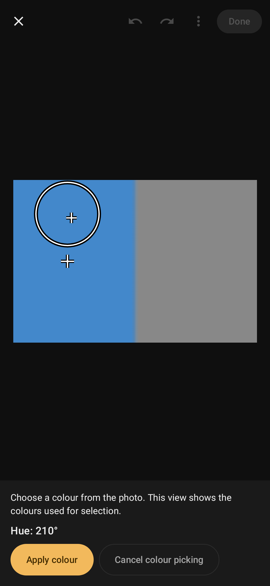
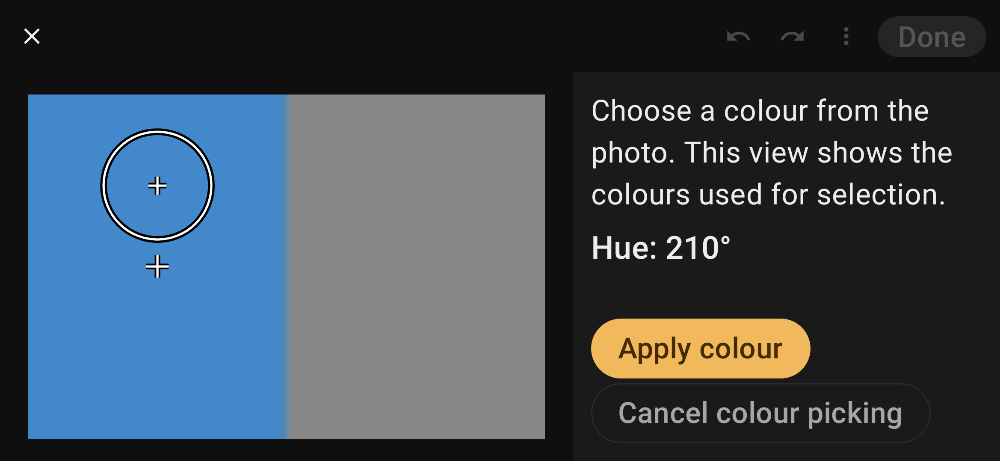

# Photo colour picker verification — 2026-10-27

Agent: Codex. Base: `14d3890`. Branch: `codex/colour-picker-design`.

The owner approved the design and implementation. This branch implements photo hue picking and optional fixed
swatches; it does not change the saved edit format, Room schema or backup format.

## Local evidence

- `ANDROID_HOME=/Users/byeonggon/Library/Android/sdk ./gradlew testDebugUnitTest lintDebug lintRelease assembleDebugAndroidTest`: successful. JVM results: 802 tests, zero failures/errors, four skipped; Lint: zero errors (14 existing warnings in each variant).
- `git diff --exit-code -- app/schemas` and `git diff --check`: clean.
- New coverage: six sampler/prefix-renderer tests, twelve picker flow tests, three geometry tests and two panel tests.
  Existing editor, rendering, settings and backup tests also pass.
- The flow tests exercise real Room/application/editor state, touch-down and drag, keyboard and accessibility
  actions, one-step Undo, no-op Apply, Cancel/Back, achromatic rejection, stale close/reopen work, EXIF rotation,
  whole-photo framing, configuration recreation and device-local preference preservation.
- A new instrumentation case compares CPU/GPU output after applying a picked hue following an earlier local mask.
  It compiles; it has **not run on a device**.

## Synthetic UI captures

Robolectric Compose captures using generated blue/gray patches, not photographs or device screenshots. Visually
checked crosshair/magnifier placement and readable, reachable action labels. These do not prove phone ergonomics.

## Limits and merge gate

The Galaxy S24 Ultra was absent from `adb devices -l`. No device was installed, cleared or uninstalled for this
feature. Actual GPU parity, TalkBack, finger occlusion, responsiveness, one-hand use, lens correction and real-photo
judgement remain on [DEVICE_CHECKS.md](../../DEVICE_CHECKS.md).

Preparation IOException/OOM handling was inspected, not fault-injected; stale publication is tested at the real
close/reopen boundary. These limits must not be described as a successful on-device check.

A fresh whole-branch Codex review is supplemental. A qualified cross-family reviewer must cover the full colour,
state/cancellation, renderer and UI diff before merge, per AGENTS.md. No merge is authorized by this report.
